# Ansible & K3s Homelab Project

## 1. Voorbereiding van de Ubuntu Base Template
Om de virtuele machines efficiënt uit te rollen, is er gestart met een Ubuntu base template. 

**Instellingen van de base template:**
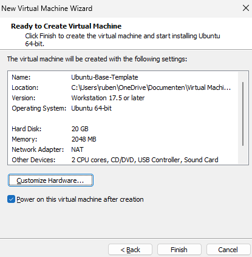

Om de template gereed te maken voor hergebruik en klonen, zijn de volgende voorbereidende stappen uitgevoerd op de base VM:

```bash
# Update het systeem en installeer benodigde tools
sudo apt update && sudo apt upgrade -y
sudo apt install -y open-vm-tools python3

# Sudo rechten instellen zonder wachtwoord voor de gebruiker 'ruben'
echo "ruben ALL=(ALL) NOPASSWD:ALL" | sudo tee /etc/sudoers.d/ruben

# Reset het machine-ID zodat gekloonde VM's niet hetzelfde netwerk-ID krijgen
sudo truncate -s 0 /etc/machine-id
sudo rm /var/lib/dbus/machine-id
sudo ln -s /etc/machine-id /var/lib/dbus/machine-id

# Sluit de VM veilig af om als template te dienen
sudo poweroff
```
*(Tijdens de installatie is gekozen voor de toetsenbordindeling French / French alt).*

## 2. Klonen van de Virtuele Machines
Vanuit de opgeschoonde base template zijn 5 'Full Clones' gemaakt (huidige staat). Dit vormt de basis van de homelab architectuur:
1. `k8s-loadbalancer`
2. `k8s-controlplane`
3. `k8s-database`
4. `k8s-worker-01`
5. `k8s-worker-02`

De SSH-verbinding naar alle geconfigureerde VM's is vervolgens geverifieerd in VS Code:
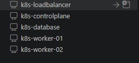

## 3. Inrichten van de Management Omgeving (WSL)
De lokale Windows-machine is ingericht als Ansible Control Node via WSL (Windows Subsystem for Linux).

```bash
# WSL installeren (Ubuntu) en Ansible voorbereiden
wsl --install -d Ubuntu
sudo apt update && sudo apt install ansible -y
sudo apt install sshpass -y

# Mappenstructuur voor Ansible rollen aanmaken
mkdir -p roles
cd roles
ansible-galaxy init loadbalancer
ansible-galaxy init database
ansible-galaxy init k8s_controlplane
ansible-galaxy init k8s_worker
cd ..

# SSH-configuratie overnemen vanuit Windows voor naadloze verbindingen
mkdir -p ~/.ssh
cp /mnt/c/Users/ruben/.ssh/config ~/.ssh/config
chmod 600 ~/.ssh/config
```

## 4. Ansible Inventory Configuratie
Om Ansible te vertellen welke servers er bestaan, is het inventory-bestand `inventory/hosts.ini` aangemaakt met de volgende indeling:

```ini
[loadbalancers]
k8s-loadbalancer

[control_plane]
k8s-controlplane

[database]
k8s-database

[workers]
k8s-worker-01
k8s-worker-02

[k3s_cluster:children]
control_plane
workers
```

## 5. Uitrol van de Loadbalancer (HAProxy)
De eerste Ansible-rol is geconfigureerd om HAProxy te installeren op de loadbalancer VM. 

**Bestand:** `roles/loadbalancer/tasks/main.yml`
```yaml
---
- name: Installeer HAProxy
  apt:
    name: haproxy
    state: present
    update_cache: yes

- name: Zorg dat HAProxy is ingeschakeld en draait
  service:
    name: haproxy
    state: started
    enabled: yes
```

Om dit uit te voeren is het hoofd-playbook `site.yml` aangemaakt:
```yaml
---
- name: Configureer de Loadbalancer
  hosts: loadbalancers
  become: yes
  roles:
    - loadbalancer
```

**Uitvoering:** `ansible-playbook site.yml -k -K`
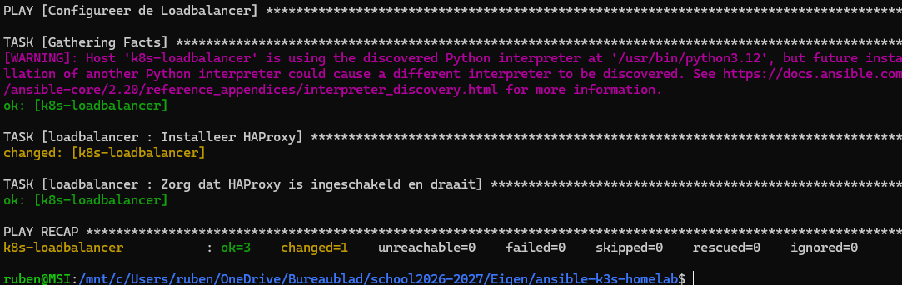

## 6. Uitrol van de Kubernetes Control Plane
Vervolgens is de rol voor de K3s Control Plane geschreven en toegevoegd aan het cluster.

**Bestand:** `roles/k8s_controlplane/tasks/main.yml`
```yaml
---
- name: Download en installeer K3s Control Plane
  shell: curl -sfL https://get.k3s.io | sh -
  args:
    creates: /usr/local/bin/k3s

- name: Controleer of K3s succesvol is gestart
  service:
    name: k3s
    state: started
    enabled: yes
```

**Toevoeging in `site.yml`:**
```yaml
- name: Configureer de Kubernetes Control Plane
  hosts: control_plane
  become: yes
  roles:
    - k8s_controlplane
```

**Uitvoering:** `ansible-playbook -i inventory/hosts.ini site.yml -k -K`
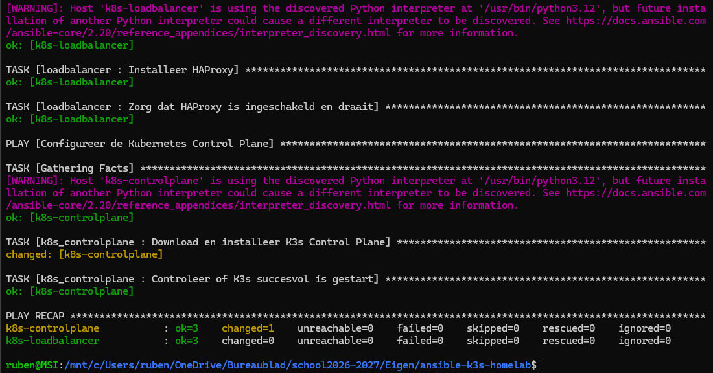

## 7. Uitrol van de Kubernetes Workers
Om de workers te kunnen koppelen, moet de Control Plane eerst het unieke node-token vrijgeven. Dit is toegevoegd aan de Control Plane taken, waarna de worker-installatie is geschreven.

**Toevoeging in `roles/k8s_controlplane/tasks/main.yml`:**
```yaml
- name: Haal het node-token op voor de workers
  command: cat /var/lib/rancher/k3s/server/node-token
  register: k3s_token
  changed_when: false
```

**Bestand:** `roles/k8s_worker/tasks/main.yml`
```yaml
---
- name: Installeer K3s Agent (Worker) en join het cluster
  shell: curl -sfL https://get.k3s.io | K3S_URL=https://192.168.15.132:6443 K3S_TOKEN={{ hostvars['k8s-controlplane']['k3s_token']['stdout'] | trim }} sh -
  args:
    creates: /etc/systemd/system/k3s-agent.service

- name: Zorg dat de K3s Agent service draait
  service:
    name: k3s-agent
    state: started
    enabled: yes
```

**Toevoeging in `site.yml`:**
```yaml
- name: Configureer de Kubernetes Workers
  hosts: workers
  become: yes
  roles:
    - k8s_worker
```

**Uitvoering:** `ansible-playbook -i inventory/hosts.ini site.yml -k -K`
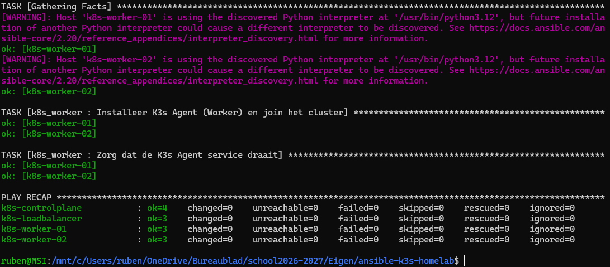

**Verificatie van het cluster:**
Via SSH is gecontroleerd of de Control Plane beide worker nodes succesvol ziet:
```bash
ssh k8s-controlplane
sudo k3s kubectl get nodes
```
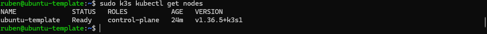

## 8. Globale Systeemconfiguratie (Hostnames & Hosts-bestand)
Om netwerkproblemen binnen het cluster te voorkomen, is er een basisconfiguratie toegevoegd die op *alle* servers wordt toegepast. Deze configuratie stelt de juiste Linux hostname in en koppelt deze aan het lokale loopback-adres.

**Toevoeging bovenaan in `site.yml`:**
```yaml
---
- name: Basisconfiguratie voor alle servers
  hosts: all
  become: yes
  tasks:
    - name: Stel de juiste Linux hostname in
      hostname:
        name: "{{ inventory_hostname }}"

    - name: Update /etc/hosts voor netwerkstabiliteit
      lineinfile:
        path: /etc/hosts
        regexp: '^127\.0\.1\.1'
        line: "127.0.1.1 {{ inventory_hostname }}"
```

## 9. Correctie en Herstart van de Kubernetes Nodes
Om te garanderen dat de K3s agent altijd de meest recente configuratie oppakt, is een blokkerende regel (`creates: /etc/systemd/system/k3s-agent.service`) verwijderd uit de worker playbook.

**Aanpassing in `roles/k8s_worker/tasks/main.yml`:**
De `args:` sectie met de `creates` voorwaarde is verwijderd uit de installatietaak.

Daarna is het playbook opnieuw uitgerold om de systeemconfiguratie (hostnames) en worker-updates toe te passen:
**Uitvoering:** `ansible-playbook -i inventory/hosts.ini site.yml -k -K`
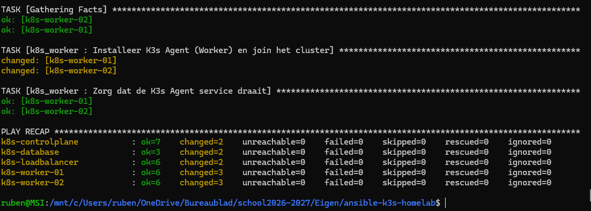

## 10. Cluster Cleanup en Verificatie
Na de wijzigingen is de Control Plane herstart en is het cluster opgeschoond. De originele Ubuntu base-template, die per ongeluk door K3s als node was geregistreerd, is handmatig verwijderd.

```bash
# Herstart de Control Plane service
ssh k8s-controlplane "sudo systemctl restart k3s"

# Controleer de status van de aangesloten nodes
ssh k8s-controlplane "sudo k3s kubectl get nodes"
```
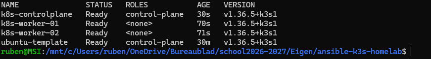

```bash
# Verwijder de vervuilde template node uit het cluster
ssh k8s-controlplane "sudo k3s kubectl delete node ubuntu-template"
```

## 11. Uitrol en Beveiliging van de MariaDB Database
Voor de opslag van de applicatiedata is een MariaDB databaseserver geconfigureerd. De initiële rol installeert de service en verwijdert direct onveilige anonieme standaardgebruikers.

**Bestand:** `roles/database/tasks/main.yml`
```yaml
---
- name: Installeer MariaDB Server
  apt:
    name: mariadb-server
    state: present
    update_cache: yes

- name: Zorg dat MariaDB draait en start bij boot
  service:
    name: mariadb
    state: started
    enabled: yes

- name: Verwijder anonieme gebruikers uit de database
  command: mysql -u root -e "DELETE FROM mysql.user WHERE User='';"
  changed_when: false

- name: Test de database verbinding
  command: mysqladmin -u root ping
  register: db_status
  changed_when: false

- name: Controleer of de database luistert
  debug:
    msg: "Database status: {{ db_status.stdout }}"
```

**Toevoeging in `site.yml` (tussen loadbalancer en control_plane):**
```yaml
- name: Configureer de Database
  hosts: database
  become: yes
  roles:
    - database
```

**Uitvoering:** `ansible-playbook -i inventory/hosts.ini site.yml -k -K`
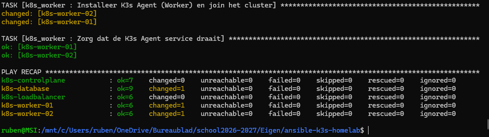

## 12. Initialisatie van de ICT Blog Database via SQL
Om de database klaar te maken voor de webapplicatie, is er een SQL-script geschreven dat de structuur (tabellen) en de eerste testdata (thema's) aanmaakt. Ook is er een specifieke gebruiker (`blog_user`) aangemaakt.

**Bestand:** `roles/database/files/init_blog.sql`
```sql
-- 1. Database en Gebruiker aanmaken
CREATE DATABASE IF NOT EXISTS ict_blog;
CREATE USER IF NOT EXISTS 'blog_user'@'%' IDENTIFIED BY 'K3sBlogApp2026!';
GRANT ALL PRIVILEGES ON ict_blog.* TO 'blog_user'@'%';
FLUSH PRIVILEGES;

USE ict_blog;

-- 2. Tabel voor de drop-down menu thema's
CREATE TABLE IF NOT EXISTS themes (
    id INT AUTO_INCREMENT PRIMARY KEY,
    name VARCHAR(50) NOT NULL UNIQUE
);

-- 3. Tabel voor de blog posts
CREATE TABLE IF NOT EXISTS posts (
    id INT AUTO_INCREMENT PRIMARY KEY,
    author_name VARCHAR(100) NOT NULL,
    theme_id INT,
    content TEXT NOT NULL,
    created_at TIMESTAMP DEFAULT CURRENT_TIMESTAMP,
    FOREIGN KEY (theme_id) REFERENCES themes(id)
);

-- 4. Standaard thema's inladen (IGNORE zorgt dat hij ze niet dubbel toevoegt bij een 2e run)
INSERT IGNORE INTO themes (id, name) VALUES (1, 'Cloud & Infrastructure');
INSERT IGNORE INTO themes (id, name) VALUES (2, 'Netwerk Security');
INSERT IGNORE INTO themes (id, name) VALUES (3, 'Ansible Automation');
INSERT IGNORE INTO themes (id, name) VALUES (4, 'Linux & Open Source');
```

Om dit SQL-script uit te voeren en de database bereikbaar te maken voor de Kubernetes workers, is de database playbook uitgebreid. De MariaDB 'bind-address' is aangepast naar `0.0.0.0` zodat netwerkverkeer wordt geaccepteerd.

**Update van `roles/database/tasks/main.yml`:**
```yaml
---
- name: Installeer MariaDB Server
  apt:
    name: mariadb-server
    state: present
    update_cache: yes

- name: Zorg dat MariaDB op het netwerk luistert (voor de Kubernetes workers)
  lineinfile:
    path: /etc/mysql/mariadb.conf.d/50-server.cnf
    regexp: '^bind-address'
    line: 'bind-address            = 0.0.0.0'
  register: mariadb_netwerk

- name: Herstart MariaDB als de netwerkconfiguratie is aangepast
  service:
    name: mariadb
    state: restarted
  when: mariadb_netwerk.changed

- name: Zorg dat MariaDB draait en start bij boot
  service:
    name: mariadb
    state: started
    enabled: yes

- name: Verwijder anonieme gebruikers uit de database (Beveiliging)
  command: mysql -u root -e "DELETE FROM mysql.user WHERE User='';"
  changed_when: false

- name: Kopieer het SQL-schema naar de database server
  copy:
    src: init_blog.sql
    dest: /tmp/init_blog.sql

- name: Importeer het SQL-schema (Database, Tabellen en Thema's)
  shell: mysql -u root < /tmp/init_blog.sql
  changed_when: false

- name: Test of de ict_blog database succesvol is aangemaakt
  command: mysql -u root -e "SHOW DATABASES LIKE 'ict_blog';"
  register: db_status
  changed_when: false

- name: Toon succesbericht
  debug:
    msg: "De ICT Blog database is live en gevuld met thema's!"
```

**Uitvoering:** `ansible-playbook -i inventory/hosts.ini site.yml -k -K`
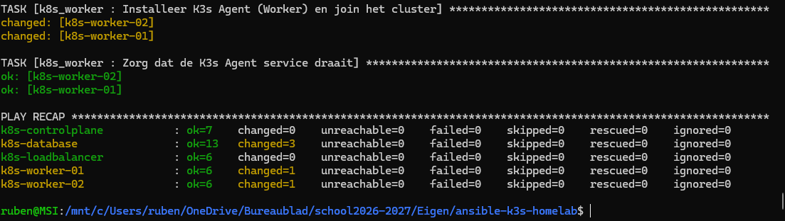

## 13. Loadbalancer Routing Configuratie (HAProxy)
Om inkomend webverkeer te verdelen over de Kubernetes workers, is er een dynamisch configuratietemplate (Jinja2) aangemaakt voor HAProxy. Al het verkeer op poort 80 wordt via het *Round Robin* principe (om de beurt) doorgestuurd naar de Traefik Ingress van de worker nodes.

**Bestand:** `roles/loadbalancer/templates/haproxy.cfg.j2`
```haproxy
global
    log /dev/log local0
    log /dev/log local1 notice
    chroot /var/lib/haproxy
    stats socket /run/haproxy/admin.sock mode 660 level admin expose-fd listeners
    stats timeout 30s
    user haproxy
    group haproxy
    daemon

defaults
    log global
    mode http
    option httplog
    option dontlognull
    timeout connect 5000
    timeout client  50000
    timeout server  50000

frontend http_front
    bind *:80
    # Al het verkeer wordt naar de K3s cluster backend gestuurd
    default_backend k3s_workers

backend k3s_workers
    balance roundrobin
    # Stuur het verkeer naar de Traefik Ingress (poort 80) van je worker nodes
    server k8s-worker-01 192.168.15.134:80 check
    server k8s-worker-02 192.168.15.135:80 check
```

Om dit template correct te plaatsen, is de loadbalancer rol bijgewerkt met een automatische herstart-trigger.

**Update in `roles/loadbalancer/tasks/main.yml`:**
```yaml
---
- name: Installeer HAProxy
  apt:
    name: haproxy
    state: present
    update_cache: yes

- name: Plaats de HAProxy configuratie (via template)
  template:
    src: haproxy.cfg.j2
    dest: /etc/haproxy/haproxy.cfg
  register: haproxy_config

- name: Herstart HAProxy als de configuratie is aangepast
  service:
    name: haproxy
    state: restarted
  when: haproxy_config.changed

- name: Zorg dat HAProxy draait en start bij boot
  service:
    name: haproxy
    state: started
    enabled: yes
```

**Uitvoering:** `ansible-playbook -i inventory/hosts.ini site.yml -k -K`
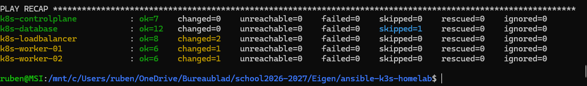

## 14. Applicatie Manifest (ICT Blog)
De daadwerkelijke webapplicatie is vastgelegd in een Kubernetes manifest. Dit YAML-bestand beschrijft een Deployment (met een custom PHP-container), een Service, en een Ingress-route. De applicatie maakt direct verbinding met de eerder uitgerolde MariaDB database op `192.168.15.133`.

**Bestand:** `k8s-manifests/blog-app.yaml`
```yaml
apiVersion: apps/v1
kind: Deployment
metadata:
  name: ict-blog-deployment
spec:
  replicas: 2
  selector:
    matchLabels:
      app: ict-blog
  template:
    metadata:
      labels:
        app: ict-blog
    spec:
      containers:
      - name: web
        image: php:8.2-apache
        ports:
        - containerPort: 80
        env:
        - name: DB_HOST
          value: "192.168.15.133"
        - name: DB_USER
          value: "blog_user"
        - name: DB_PASS
          value: "K3sBlogApp2026!"
        - name: DB_NAME
          value: "ict_blog"
        command: ["/bin/sh", "-c"]
        args:
          - |
            docker-php-ext-install mysqli pdo pdo_mysql > /dev/null 2>&1
            cat << 'EOF' > /var/www/html/index.php
            <?php
            $host = getenv('DB_HOST');
            $user = getenv('DB_USER');
            $pass = getenv('DB_PASS');
            $dbname = getenv('DB_NAME');

            $conn = new mysqli($host, $user, $pass, $dbname);
            if ($conn->connect_error) {
                die("<h3 style='color:red;'>Database Verbinding Mislukt: " . $conn->connect_error . "</h3>");
            }

            // Verwerk formulier indien verstuurd
            if ($_SERVER['REQUEST_METHOD'] === 'POST') {
                $author = $conn->real_escape_string($_POST['author']);
                $theme_id = intval($_POST['theme_id']);
                $content = $conn->real_escape_string($_POST['content']);
                if (!empty($author) && !empty($content)) {
                    $conn->query("INSERT INTO posts (author_name, theme_id, content) VALUES ('$author', $theme_id, '$content')");
                    header("Refresh:0");
                }
            }

            $themes = $conn->query("SELECT * FROM themes");
            $posts = $conn->query("SELECT p.*, t.name as theme_name FROM posts p JOIN themes t ON p.theme_id = t.id ORDER BY p.created_at DESC");
            ?>
            <!DOCTYPE html>
            <html>
            <head>
                <title>Infra & Netwerk ICT Blog</title>
                <style>
                    body { font-family: Arial, sans-serif; background: #f4f6f9; margin: 0; padding: 20px; }
                    .container { max-width: 800px; background: white; padding: 30px; margin: auto; border-radius: 8px; box-shadow: 0 4px 8px rgba(0,0,0,0.1); }
                    h1 { color: #004085; border-bottom: 2px solid #004085; padding-bottom: 10px; }
                    form { background: #e9ecef; padding: 20px; border-radius: 6px; margin-bottom: 30px; }
                    input, select, textarea { width: 100%; padding: 10px; margin: 8px 0 15px 0; border: 1px solid #ced4da; border-radius: 4px; box-sizing: border-box; }
                    button { background: #007bff; color: white; padding: 10px 20px; border: none; border-radius: 4px; cursor: pointer; font-size: 16px; }
                    button:hover { background: #0056b3; }
                    .post { background: #fff; border-left: 4px solid #007bff; padding: 15px; margin-bottom: 15px; box-shadow: 0 2px 4px rgba(0,0,0,0.05); }
                    .post h4 { margin: 0 0 5px 0; color: #333; }
                    .meta { font-size: 12px; color: #6c757d; margin-bottom: 10px; }
                </style>
            </head>
            <body>
                <div class="container">
                    <h1>🚀 Infra & Netwerk ICT Blog</h1>
                    <p><em>Gedraaid op Kubernetes (K3s) & beheerd via Ansible</em></p>
                    
                    <form method="POST">
                        <h3>Nieuwe Blogpost Schrijven</h3>
                        <label>Jouw Naam:</label>
                        <input type="text" name="author" required placeholder="Bijv. Ruben">
                        
                        <label>Thema:</label>
                        <select name="theme_id">
                            <?php while($row = $themes->fetch_assoc()): ?>
                                <option value="<?= $row['id']; ?>"><?= $row['name']; ?></option>
                            <?php endwhile; ?>
                        </select>

                        <label>Inhoud:</label>
                        <textarea name="content" rows="4" required placeholder="Schrijf hier je update over netwerken, linux of homelabs..."></textarea>
                        
                        <button type="submit">Publiceer Post</button>
                    </form>

                    <h3>Recente Artikelen</h3>
                    <?php if ($posts->num_rows > 0): ?>
                        <?php while($post = $posts->fetch_assoc()): ?>
                            <div class="post">
                                <h4><?= htmlspecialchars($post['author_name']); ?> <span style="font-size:13px; font-weight:normal; color:#007bff;">[<?= htmlspecialchars($post['theme_name']); ?>]</span></h4>
                                <div class="meta"><?= $post['created_at']; ?></div>
                                <p><?= nl2br(htmlspecialchars($post['content'])); ?></p>
                            </div>
                        <?php endwhile; ?>
                    <?php else: ?>
                        <p>Nog geen posts geplaatst. Wees de eerste!</p>
                    <?php endif; ?>
                </div>
            </body>
            </html>
            EOF
            apache2-foreground
---
apiVersion: v1
kind: Service
metadata:
  name: ict-blog-service
spec:
  selector:
    app: ict-blog
  ports:
    - port: 80
      targetPort: 80
---
apiVersion: networking.k8s.io/v1
kind: Ingress
metadata:
  name: ict-blog-ingress
  annotations:
    traefik.ingress.kubernetes.io/router.entrypoints: web
spec:
  rules:
  - http:
      paths:
      - path: /
        pathType: Prefix
        backend:
          service:
            name: ict-blog-service
            port:
              number: 80
```

## 15. Ansible Uitrol van de Applicatie & Netwerktoegang
Om dit manifest uit te rollen is een nieuwe `k8s_app` Ansible rol aangemaakt die het bestand naar de Control Plane kopieert en toepast via `kubectl apply`. 

Daarnaast is er een cruciale beveiligingsaanpassing gedaan op de databaseserver: de Ubuntu firewall (UFW) is uitgeschakeld zodat de worker-nodes de MariaDB poort (3306) kunnen bereiken.

**Toevoeging bovenaan in `roles/database/tasks/main.yml`:**
```yaml
---
- name: Schakel de UFW firewall uit (Homelab setting)
  service:
    name: ufw
    state: stopped
    enabled: no
```

**Bestand:** `roles/k8s_app/tasks/main.yml`
```yaml
---
- name: Maak de manifestenmap aan op de Control Plane
  file:
    path: /tmp/k8s-manifests
    state: directory

- name: Kopieer de blog Kubernetes manifesten naar de Control Plane
  copy:
    src: k8s-manifests/blog-app.yaml
    dest: /tmp/k8s-manifests/blog-app.yaml

- name: Pas de website toe op het Kubernetes cluster
  command: sudo k3s kubectl apply -f /tmp/k8s-manifests/blog-app.yaml
  changed_when: false
```

**Toevoeging onderaan in `site.yml`:**
```yaml
- name: Configureer de Kubernetes Applicatie (ICT Blog)
  hosts: control_plane
  become: yes
  roles:
    - k8s_app
```

**Definitieve Uitrol:** `ansible-playbook -i inventory/hosts.ini site.yml -k -K`
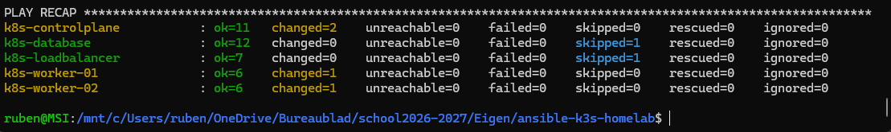

## 16. Eindverificatie
Na de uitrol is het IP-adres van de HAProxy loadbalancer in de browser geopend (`http://192.168.15.131`). De webapplicatie laadt correct, wat bewijst dat de loadbalancer het verkeer routeert, Kubernetes de containers draait, en de connectie met de MariaDB-database succesvol is opgezet.

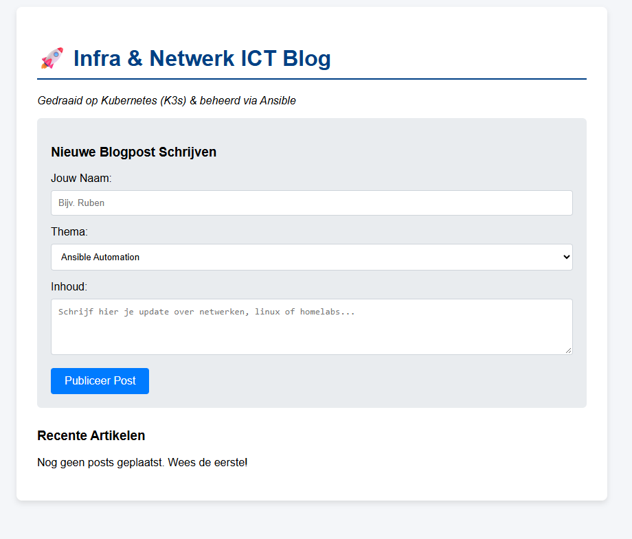


## 17. Loadbalancer Verificatie & Node-detectie
Om visueel aan te tonen dat de loadbalancer (HAProxy) het verkeer daadwerkelijk afwisselend over de twee worker-nodes verdeelt, zijn er twee verificatiemethoden toegevoegd: een intern HAProxy dashboard en een node-detectie script in de applicatie zelf.

**17.1 HAProxy Stats Dashboard activeren**
Aan het `haproxy.cfg.j2` template is een blok toegevoegd dat poort 8404 opent voor het ingebouwde statistiekenpaneel.

**Toevoeging onderaan in `roles/loadbalancer/templates/haproxy.cfg.j2`:**
```haproxy
listen stats
    bind *:8404
    stats enable
    stats uri /stats
    stats refresh 2s
    stats show-node
```

**17.2 Node-detectie in de Applicatie (Downward API)**
Het Kubernetes manifest is bijgewerkt om de naam van de actieve worker-node uit te lezen via de Kubernetes Downward API (`spec.nodeName`) en deze bovenaan de website te tonen in een groene banner.

**Update van `k8s-manifests/blog-app.yaml`:**
```yaml
apiVersion: apps/v1
kind: Deployment
metadata:
  name: ict-blog-deployment
spec:
  replicas: 2
  selector:
    matchLabels:
      app: ict-blog
  template:
    metadata:
      labels:
        app: ict-blog
    spec:
      containers:
      - name: web
        image: php:8.2-apache
        ports:
        - containerPort: 80
        env:
        - name: DB_HOST
          value: "192.168.15.133"
        - name: DB_USER
          value: "blog_user"
        - name: DB_PASS
          value: "K3sBlogApp2026!"
        - name: DB_NAME
          value: "ict_blog"
        - name: K8S_NODE_NAME
          valueFrom:
            fieldRef:
              fieldPath: spec.nodeName
        command: ["/bin/sh", "-c"]
        args:
          - |
            docker-php-ext-install mysqli pdo pdo_mysql > /dev/null 2>&1
            cat << 'EOF' > /var/www/html/index.php
            <?php
            $host = getenv('DB_HOST');
            $user = getenv('DB_USER');
            $pass = getenv('DB_PASS');
            $dbname = getenv('DB_NAME');
            $node_name = getenv('K8S_NODE_NAME') ?: 'Onbekende Node';

            $conn = new mysqli($host, $user, $pass, $dbname);
            if ($conn->connect_error) {
                die("<h3 style='color:red;'>Database Verbinding Mislukt: " . $conn->connect_error . "</h3>");
            }

            if ($_SERVER['REQUEST_METHOD'] === 'POST') {
                $author = $conn->real_escape_string($_POST['author']);
                $theme_id = intval($_POST['theme_id']);
                $content = $conn->real_escape_string($_POST['content']);
                if (!empty($author) && !empty($content)) {
                    $conn->query("INSERT INTO posts (author_name, theme_id, content) VALUES ('$author', $theme_id, '$content')");
                    header("Location: " . $_SERVER['PHP_SELF']);
                    exit;
                }
            }

            $themes = $conn->query("SELECT * FROM themes");
            $posts = $conn->query("SELECT p.*, t.name as theme_name FROM posts p JOIN themes t ON p.theme_id = t.id ORDER BY p.created_at DESC");
            ?>
            <!DOCTYPE html>
            <html>
            <head>
                <title>Infra & Netwerk ICT Blog</title>
                <style>
                    body { font-family: Arial, sans-serif; background: #f4f6f9; margin: 0; padding: 20px; }
                    .container { max-width: 800px; background: white; padding: 30px; margin: auto; border-radius: 8px; box-shadow: 0 4px 8px rgba(0,0,0,0.1); }
                    h1 { color: #004085; border-bottom: 2px solid #004085; padding-bottom: 10px; }
                    .server-badge { background: #28a745; color: white; padding: 12px; border-radius: 5px; text-align: center; font-weight: bold; margin-bottom: 25px; font-size: 16px; box-shadow: 0 2px 4px rgba(0,0,0,0.2); }
                    form { background: #e9ecef; padding: 20px; border-radius: 6px; margin-bottom: 30px; }
                    input, select, textarea { width: 100%; padding: 10px; margin: 8px 0 15px 0; border: 1px solid #ced4da; border-radius: 4px; box-sizing: border-box; }
                    button { background: #007bff; color: white; padding: 10px 20px; border: none; border-radius: 4px; cursor: pointer; font-size: 16px; }
                    button:hover { background: #0056b3; }
                    .post { background: #fff; border-left: 4px solid #007bff; padding: 15px; margin-bottom: 15px; box-shadow: 0 2px 4px rgba(0,0,0,0.05); }
                    .post h4 { margin: 0 0 5px 0; color: #333; }
                    .meta { font-size: 12px; color: #6c757d; margin-bottom: 10px; }
                </style>
            </head>
            <body>
                <div class="container">
                    <div class="server-badge">
                        🚦 Verzoek afgehandeld door Kubernetes Node: <?= htmlspecialchars($node_name); ?>
                    </div>
                    <h1>🚀 Infra & Netwerk ICT Blog</h1>
                    <p><em>Gedraaid op Kubernetes (K3s) & beheerd via Ansible</em></p>
                    
                    <form method="POST">
                        <h3>Nieuwe Blogpost Schrijven</h3>
                        <label>Jouw Naam:</label>
                        <input type="text" name="author" required placeholder="Bijv. Ruben">
                        
                        <label>Thema:</label>
                        <select name="theme_id">
                            <?php while($row = $themes->fetch_assoc()): ?>
                                <option value="<?= $row['id']; ?>"><?= $row['name']; ?></option>
                            <?php endwhile; ?>
                        </select>

                        <label>Inhoud:</label>
                        <textarea name="content" rows="4" required placeholder="Schrijf hier je update over netwerken, linux of homelabs..."></textarea>
                        
                        <button type="submit">Publiceer Post</button>
                    </form>

                    <h3>Recente Artikelen</h3>
                    <?php if ($posts && $posts->num_rows > 0): ?>
                        <?php while($post = $posts->fetch_assoc()): ?>
                            <div class="post">
                                <h4><?= htmlspecialchars($post['author_name']); ?> <span style="font-size:13px; font-weight:normal; color:#007bff;">[<?= htmlspecialchars($post['theme_name']); ?>]</span></h4>
                                <div class="meta"><?= $post['created_at']; ?></div>
                                <p><?= nl2br(htmlspecialchars($post['content'])); ?></p>
                            </div>
                        <?php endwhile; ?>
                    <?php else: ?>
                        <p>Nog geen posts geplaatst. Wees de eerste!</p>
                    <?php endif; ?>
                </div>
            </body>
            </html>
            EOF
            apache2-foreground
---
apiVersion: v1
kind: Service
metadata:
  name: ict-blog-service
spec:
  selector:
    app: ict-blog
  ports:
    - port: 80
      targetPort: 80
---
apiVersion: networking.k8s.io/v1
kind: Ingress
metadata:
  name: ict-blog-ingress
  annotations:
    traefik.ingress.kubernetes.io/router.entrypoints: web
spec:
  rules:
  - http:
      paths:
      - path: /
        pathType: Prefix
        backend:
          service:
            name: ict-blog-service
            port:
              number: 80
```

**Resultaat:**
Door meermaals de pagina op `http://192.168.15.131` te vernieuwen, is waargenomen dat de actieve node afwisselt tussen `k8s-worker-01` en `k8s-worker-02`. Het HAProxy dashboard (`http://192.168.15.131:8404/stats`) toont daarnaast exact de verdeling van de actieve sessies over de backends.
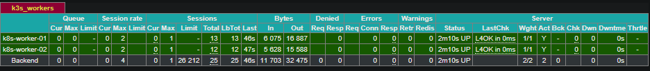

## 18. Kubernetes Dashboard UI (Portainer) Installatie
Voor grafisch beheer van het K3s-cluster is Portainer geïnstalleerd. Dit gebeurt eveneens geautomatiseerd via een nieuwe Ansible-rol (`k8s_ui`).

**Bestand:** `roles/k8s_ui/tasks/main.yml`
```yaml
---
- name: Controleer en maak de portainer namespace aan
  shell: sudo k3s kubectl get namespace portainer || sudo k3s kubectl create namespace portainer
  changed_when: false

- name: Installeer Portainer (Kubernetes UI)
  command: sudo k3s kubectl apply -n portainer -f https://downloads.portainer.io/ce-lts/portainer.yaml
  changed_when: false
  
- name: Wacht tot Portainer is opgestart
  command: sudo k3s kubectl wait --for=condition=available --timeout=120s deployment/portainer -n portainer
  changed_when: false
```

**Toevoeging in `site.yml`:**
```yaml
- name: Configureer de Kubernetes Dashboard UI (Portainer)
  hosts: control_plane
  become: yes
  roles:
    - k8s_ui
```

**Uitvoering:**
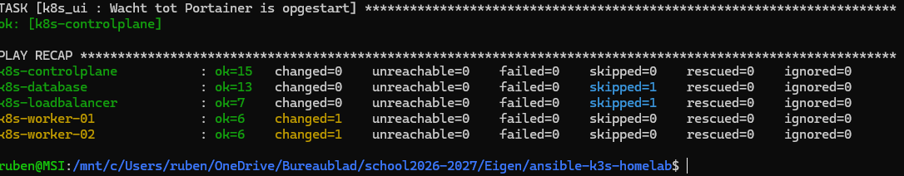

## 19. Portainer Configuratie & Cluster Overzicht
Na uitrol is de Portainer-interface benaderbaar via de standaard NodePort (`30777`) op het IP van de Control Plane.
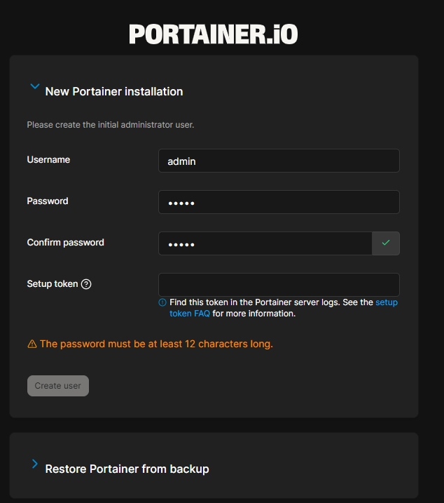

Omdat de nieuwste LTS-versie van Portainer streng beveiligd is, moest het initiële setup-token rechtstreeks uit de containerlogs gehaald worden via:
```bash
ssh k8s-controlplane "sudo k3s kubectl logs deploy/portainer -n portainer"
```

Tijdens de setup is het account geconfigureerd en is de 'Edge Compute' feature overgeslagen, aangezien dit een lokaal cluster betreft.
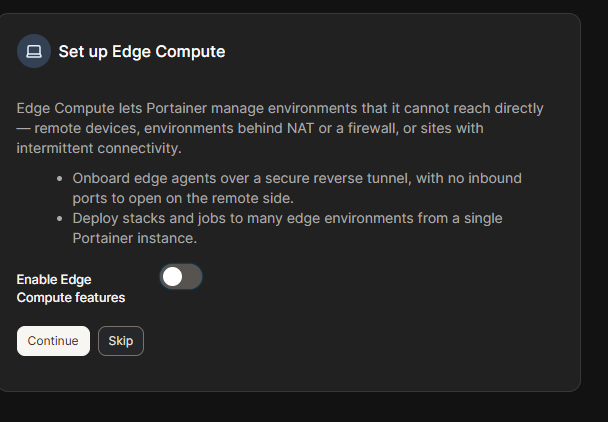

Na het voltooien van de setup is het dashboard zichtbaar. Het toont live statistieken en geeft een helder overzicht van alle draaiende nodes (Control Plane en Workers) en geïmplementeerde applicaties in het homelab.
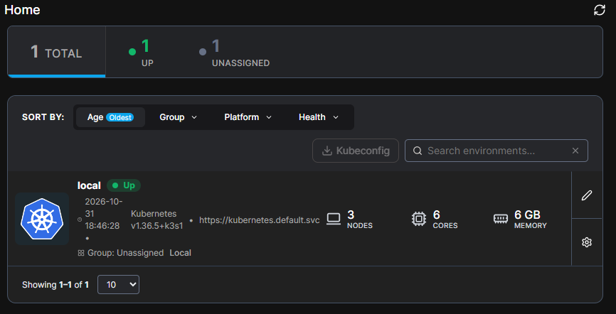
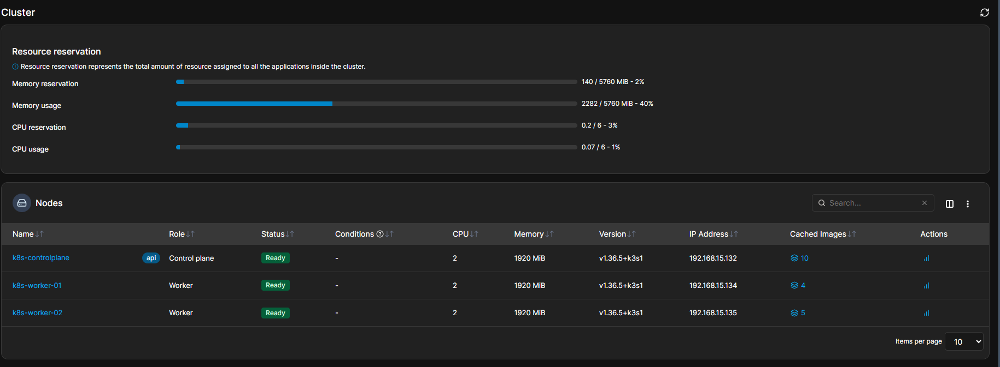